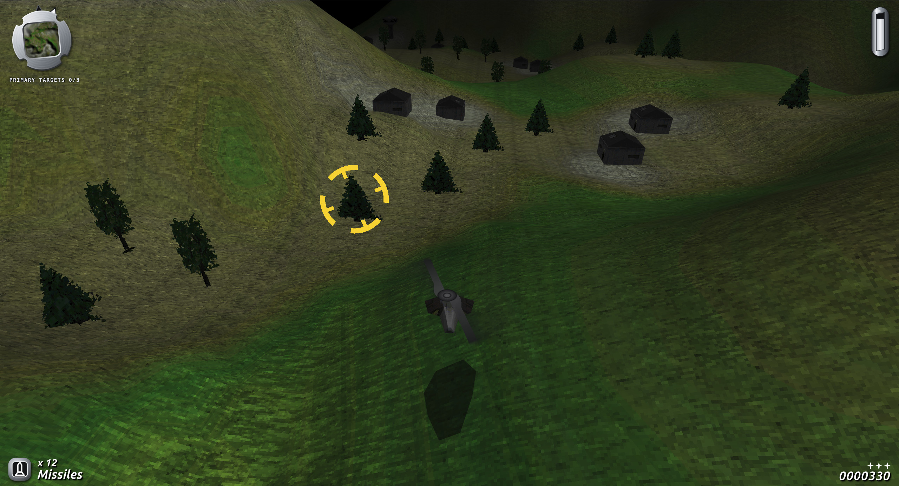

# SWIV 3D — Rust + WebAssembly + WebGL 2

A browser rebuild of **SWIV 3D** (SCi, 1996) that runs on the original game data.



The data formats and the player flight model were reverse-engineered from the original
executables, whose Watcom debug symbols survive (see [docs/formats.md](docs/formats.md)).
The earlier Unity fan remake (<https://github.com/bertyhell/swiv3d>) was used only as a
reference for feel; the original binaries are the source of truth.

## Layout

| path | what |
|------|------|
| `crates/swiv-formats` | parsers: BD/SLV bundles, heightmaps, colour maps, palettes, shade tables, texture pages, models, spawn lists, UI strings, sounds |
| `crates/swiv-core` | deterministic fixed-tick simulation; exact integer port of `CONTROL_keyboard_1H` + `OBFUNC_heli_base` |
| `crates/swiv-web` | wasm-bindgen entry point and WebGL 2 renderer |
| `tools/swiv-extract` | CLI that dumps everything to PNG / OBJ / WAV / JSON, rips CD audio, converts Smacker videos |
| `web/` | page, HUD, input, audio, file loading |
| `web/frontend.js` | the original's menus (pilots, controller, main menu, setup, credits) |
| `web/briefing.js` | the mission briefing, timed and laid out after the BR_TER* videos and their `.SCR` overlay scripts, with close-ups rendered by the game |
| `web/intro.js` | the opening cinematic, rebuilt in real time with three.js (vendored in `web/vendor/`, MIT), shot for shot and frame-timed against INTRO1/INTRO2 |
| `docs/formats.md` | byte-level format notes and the flight model |

## Play

Run these from this `remake/` folder:

```bash
rustup target add wasm32-unknown-unknown
cargo install wasm-bindgen-cli --version 0.2.100
./build.sh
cargo run --release -p swiv-extract --bin swiv-pack -- "../original/SWIV 3D (1996)/SWIV3D/cd/cd/GameData" web/assets --music ../mp3 \
    --anims "../original/SWIV 3D (1996)/SWIV3D/cd/cd/Anims"
python3 -m http.server -d web 8080
```

`swiv-pack` converts the game data once into `web/assets/`: every level's height, type and
colour maps and its texture pages as 8-bit PNGs (indexed with the game's own palette, so they
view correctly and keep the exact indices the renderer needs), a slim `level.bd` per level with
the models, spawns and tables, the sound effects as WAV and the soundtrack as MP3, listed in
`manifest.json`. With `--anims` (needs ffmpeg) it also writes `intro.mp3`, the audio of the two
intro videos, which the real-time intro plays in sync (without it the intro falls back to a few
of the game's sound effects), and for each mission briefing video its soundtrack and overlay
script under `briefing/`, plus the briefing's sound effects (grid, waypoint, close-up, outro and
the hum under them; they are not in SOUNDS.BD) cut from BR_TER1 for the levels without a video. Open <http://localhost:8080> and the menu comes up straight away.

The page opens like the original: press a key, the intro plays (any key skips; add
`?intro=0` to the URL to leave it out), then the front end runs over a live flyover of a level
with the menu headings in the game's 3D font: Select Pilot, New Pilot, Controller Type, Main
Menu (Start Game, Setup, Replay Intro, Credits, New Player, Exit) and Setup (volumes, music
track, detail level). Pilots and their campaign progress are kept in `localStorage`; Start
Game shows the mission briefing before each level; `?briefing=TERRAN03` (any level name) skips
straight to that level's briefing after the first key press.

Without `web/assets/` the page asks for the game instead: click **Choose game folder** and
select the CD's `GameData` folder (or the whole CD folder). For the soundtrack, include
`swiv3d.cue` + `swiv3d.bin` (streamed straight from the image) or a `music/` folder.

Controls: arrows turn / thrust, `W` `S` thrust, `A` `D` (or `Z` `X`) strafe,
Shift + arrows strafe, Space / Ctrl fire, Enter special weapon, `Q` `E` / Tab select special, `M` map,
`N` next music track, Esc pause. Gamepads work too.

## Extract assets

```bash
cargo run --release -p swiv-extract -- "<cd>/GameData" assets-out \
    --anims "<cd>/Anims" --cue "<path>/swiv3d.cue"
```

Produces per level `height.png`, `colour.png`, `type.png`, `palette.png`, texture pages,
every model as OBJ + MTL and `spawns.json`; plus `global/strings.json`, `sounds/<effect>-<description>.wav`,
`music/trackNN.ogg` and `video/*.webm`.

## Tests

```bash
SWIV_DATA="<cd>/GameData" cargo test
```

The data tests parse all 18 levels, `GLOBAL.BD` and `SOUNDS.BD`. The simulation tests check
determinism over a scripted replay, the hover height and the decoded top speed. Without
`SWIV_DATA` the data-dependent tests skip.

## Status

Done: every data format needed to play (terrain, textures, models, spawns, palette,
sounds, strings, CD audio, video), exact player flight physics, all 17 campaign levels
loadable in order, enemies (turrets, tanks, boats, aircraft, drones, spawners), pickups,
weapons with auto-targeting, objectives and level progression, HUD, radar, map, sound
effects, engine loop and CD music.

Checked against the original running in DOSBox-X (frames and sound recorded from the
emulator): the menu flow and its look, the briefing map, the gun's rhythm (pairs of pulses,
~2.5 a second held) and its sound (a click every ~140 ms while the trigger is held), houses
taking 8 hits, and the winch cable (a thin solid red line from the belly to the item).

Approximated (not yet decompiled function by function): enemy AI tuning, weapon damage and
pickup effects, the buggy / ski vehicle changeovers, bosses' special patterns, the
briefing videos (rebuilt in real time on their scripts' timing with their own soundtracks; the
map's placement and the close-up camera are approximate), weapon sprites (drawn as procedural glows until the GLOBAL.BD sprite banks
are decoded), wreck smoke and fire, and rotor discs.
